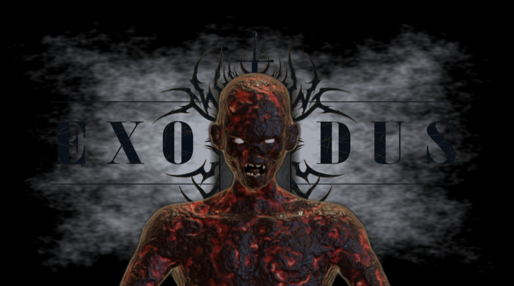

## Welcome to my GitHub profile !

I'm Thomas, a recent comp sci graduate from the South Shore of Montreal, with a passion for video games, music,
camping and bouldering !

## My game project: [ZOMBIE_GAME](https://github.com/TomBlob/ZOMBIE_GAME)

I'm designing and building my own **C++ / OpenGL** game engine from scratch, along with a **horror / roguelike / RPG**
zombie game inspired by Barony, Skyrim, The Binding of Isaac, Deep Rock Galactic, Call of Duty Zombies and Risk of Rain 2 !

- **Engine**: an ECS architecture, real-time shadows and post-processing (SSAO, bloom, ACES tone mapping)
- **Animation**: skeletal meshes I rig myself on Mixamo's skeleton, so humanoid movement can come straight from
  Mixamo animations, retargeted in the engine
- **World**: procedural BSP dungeons in the style of Barony
- **UI**: my own native UI framework (replacing ImGui) for the menus, fonts, HUD and inventory

## How I work

I use AI-assisted programming with **Claude Cowork** to speed up the coding, while I stay in charge of the design,
art, modeling, rigging, 3D animation, and eventually the music and sound design. Every asset is made by hand in
Blender: UI and inventory icons, weapons and abilities, world meshes and enemies, as showcased in the
[game's repo](https://github.com/TomBlob/ZOMBIE_GAME).
This workflow has let me build my own engine with no prior game dev experience, and I've learned a ton in under
5 months of work.

## Reach me

Open to **game dev, graphics and software engineering** opportunities.
[tom@tomblob.dev](mailto:tom@tomblob.dev) · Website (coming soon) · stay tuned ♡

## 🎵 Song of the week !

